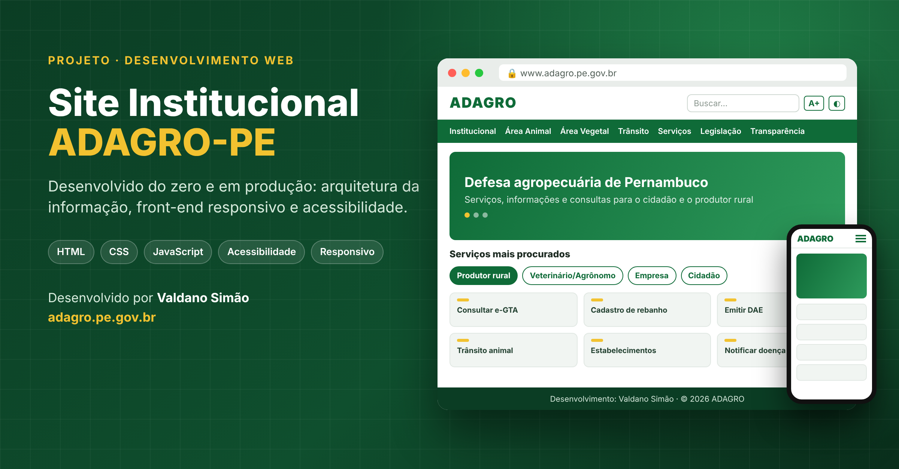
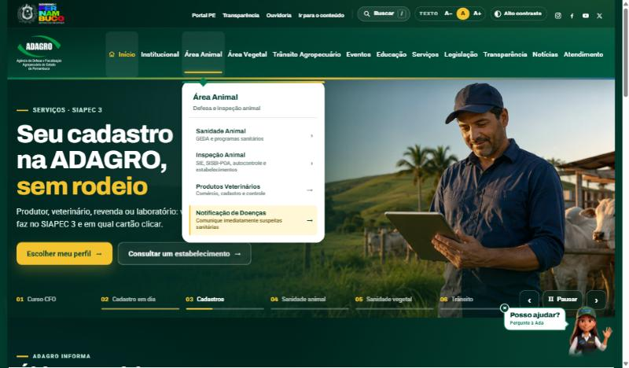
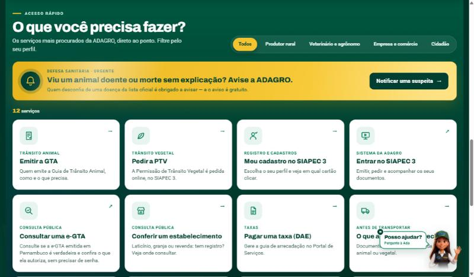
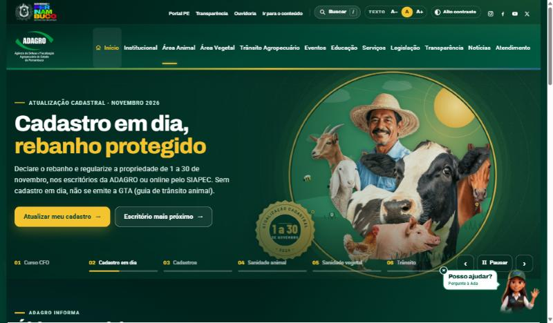
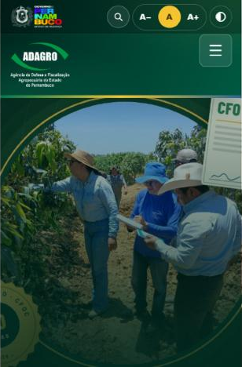
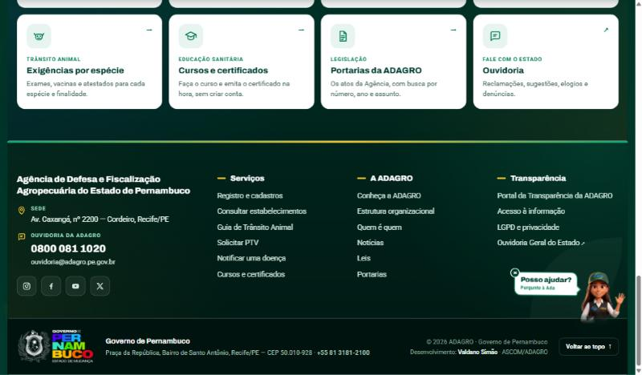

# 🌐 Site Institucional da ADAGRO-PE

> Estudo de caso do novo site da Agência de Defesa e Fiscalização Agropecuária de Pernambuco, desenvolvido do zero e hoje em produção.

🔗 **No ar:** [www.adagro.pe.gov.br](https://www.adagro.pe.gov.br)

> ℹ️ Este repositório documenta o projeto (contexto, decisões de arquitetura, UX e acessibilidade). O código-fonte pertence ao órgão e não é publicado aqui.

---

## 📌 Contexto e desafio

A ADAGRO atende públicos muito diferentes: o **produtor rural** que precisa emitir uma GTA, o **veterinário ou agrônomo** que consulta uma norma, a **empresa** que vai registrar um estabelecimento e o **cidadão** que quer avisar sobre um animal doente.

O desafio era fazer um único site falar a língua de todos eles, com informação técnica e legal confiável, acessível no celular de quem está no campo.

## 🧭 Arquitetura da informação

Organizei o conteúdo do órgão em um **mega-menu com 11 áreas** (Institucional, Área Animal, Área Vegetal, Trânsito Agropecuário, Eventos, Educação, Serviços, Legislação, Transparência, Notícias e Atendimento), cada submenu com uma descrição curta em linguagem simples.

## 🎯 "O que você precisa fazer?"

Em vez de fazer a pessoa procurar, a página inicial mostra os **12 serviços mais procurados**, com **filtro por perfil de usuário** e um **alerta sanitário em destaque** para notificação de doenças.

## ♿ Acessibilidade e responsividade

- Ajuste de tamanho do texto (A– / A / A+)
- Modo de alto contraste
- Atalho "Ir para o conteúdo" para leitores de tela
- Layout responsivo, pensado para o celular de quem acessa do campo
- Páginas de Transparência e LGPD

  
  &nbsp;
  

## 🧩 Principais funcionalidades

| Funcionalidade | Descrição |
|---|---|
| Carrossel de destaques | Campanhas e avisos com navegação, pausa e indicadores de progresso |
| Busca no topo | Busca no conteúdo do site em todas as páginas |
| Serviços por perfil | 12 serviços mais procurados filtrados por produtor, veterinário/agrônomo, empresa e cidadão |
| Consultas públicas | Acesso a validação de e-GTA, verificação de estabelecimentos e emissão de DAE (SIAPEC 3) |
| Notícias e comunicados | Últimas notícias, alertas sanitários e sala de imprensa |
| Assistente virtual | A **[Ada](https://github.com/valdanosimao/ada-assistente-virtual)**, presente em todas as páginas |

## 🛠️ Stack

`HTML5` · `CSS3` · `JavaScript` · `Template customizado sobre CMS` · `Layout responsivo` · `Desenvolvimento com apoio de agentes de IA (Claude Code)`

## 🧠 Aprendizados

- Num site público, **cada decisão de UX economiza** uma ligação, uma viagem ao escritório ou uma dúvida sem resposta.
- Organizar por **tarefa do usuário** ("o que você precisa fazer?") funciona melhor que organizar pela estrutura interna do órgão.
- Desenvolver com **agentes de IA** acelera muito a geração, a revisão e a depuração de código, desde que cada mudança seja testada no navegador.

---

👤 **Valdano Simão**, Desenvolvedor Full Stack & IA · [LinkedIn](https://www.linkedin.com/in/valdanosimao) · valdanosimao@gmail.com
